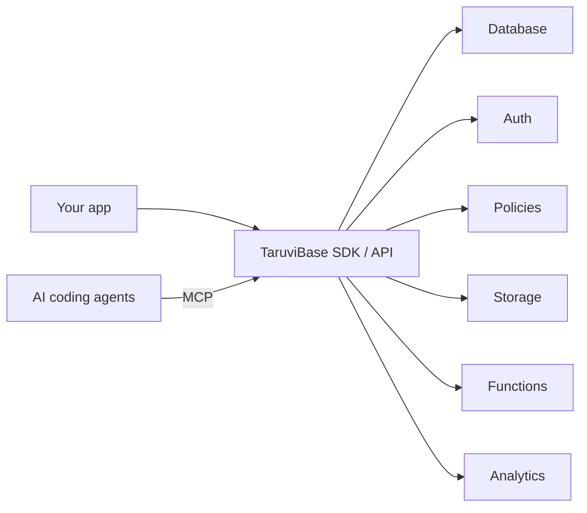

<!--
  TaruviBase GitHub org profile README
  Location: Taruvi-ai/.github/profile/README.md
-->

<p align="center">
  <a href="https://taruvibase.com/?utm_source=github&utm_medium=readme&utm_campaign=org-profile">
    
  </a>
</p>

<h1 align="center">TaruviBase</h1>

<p align="center">
  <strong>The enterprise backend for multi-tenant SaaS and AI apps.</strong><br>
  Database, auth, policies, storage, functions and analytics behind one API.
</p>

<p align="center">
  <a href="https://taruvibase.com/?utm_source=github&utm_medium=readme&utm_campaign=org-profile">Website</a> ·
  <a href="https://docs.taruvibase.com/">Docs</a> ·
  <a href="https://docs.taruvibase.com/docs/start">Get Started</a> ·
  <a href="https://www.linkedin.com/showcase/taruvibase/">LinkedIn</a> ·
  <a href="https://substack.com/@taruvibase">Blog</a>
</p>

<p align="center">
  <a href="https://www.npmjs.com/package/@taruvi/sdk"></a>
  <a href="https://pypi.org/project/taruvi/"></a>
</p>

---

## Why teams pick TaruviBase

| | |
|---|---|
| 🏢 **Multi-tenant by design** | Tenant isolation and fine-grained policies are built in, not bolted on. |
| 🔐 **Enterprise security** | Auth, access policies and audit-ready controls from day one. |
| 🤖 **AI ready** | Native MCP support lets coding agents like Claude Code, Cursor and Codex build on your backend. |
| ⚡ **Ship faster** | One API instead of six services to wire up and maintain. |

## How it works



## Start in 60 seconds

```bash
npm install @taruvi/sdk
```

```ts
import { Client, Database } from "@taruvi/sdk";

// 1. Connect to your project
const client = new Client({
  apiKey: "YOUR_API_KEY",
  appSlug: "your-app-slug",
  baseUrl: "https://your-site.taruvi.cloud",
});

// 2. Read data
const db = new Database(client);
const { data } = await db.from("accounts").execute();
```

Full walkthrough: [Quickstart](https://docs.taruvibase.com/docs/start/quickstart).

Prefer a ready app? Use the **[Refine starter template](https://github.com/Taruvi-ai/refine-starter-template)** and click **Use this template**.

## SDKs and integrations

| | Package | Install | Docs |
|---|---|---|---|
| **JavaScript / TypeScript** | [taruvi-js-sdk](https://github.com/Taruvi-ai/taruvi-js-sdk) | `npm install @taruvi/sdk` | [Guide](https://docs.taruvibase.com/docs/build/javascript) |
| **Python** | [taruvi-python-sdk](https://github.com/Taruvi-ai/taruvi-python-sdk) | `pip install taruvi` | [Guide](https://docs.taruvibase.com/docs/build/python) |
| **Refine** | `@taruvi/refine-providers` | `npm install @taruvi/refine-providers` | [Guide](https://docs.taruvibase.com/docs/build/refine) |
| **TanStack Query** | [taruvi-tanstack-query](https://github.com/Taruvi-ai/taruvi-tanstack-query) | `npm install @taruvi/tanstack-query` | [README](https://github.com/Taruvi-ai/taruvi-tanstack-query#readme) |

## Starters and tools

| Repo | What it does |
|---|---|
| [refine-starter-template](https://github.com/Taruvi-ai/refine-starter-template) | React + Refine + MUI app already wired for TaruviBase |
| [taruvibase-plugin](https://github.com/Taruvi-ai/taruvibase-plugin) | Connect Claude Code, Codex, Cursor and Kiro to TaruviBase via MCP |
| [taruvi-action](https://github.com/Taruvi-ai/taruvi-action) | Deploy frontend and backend to TaruviBase from GitHub Actions |
| [taruvi-hacks-template](https://github.com/Taruvi-ai/taruvi-hacks-template) | Hackathon starter: Refine v5 app with Codespaces and MCP setup |

## Community and support

- 📖 Questions about building? Start with the [docs](https://docs.taruvibase.com/)
- 🐛 Found a bug in an SDK? Open an issue in that repo
- ✉️ Anything else: [support@taruvibase.com](mailto:support@taruvibase.com)

---

<p align="center">
  <a href="https://taruvibase.com/?utm_source=github&utm_medium=readme&utm_campaign=org-profile"><strong>Start building →</strong></a>
</p>
